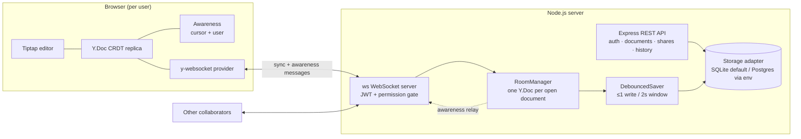

# Real-Time Collaborative Document Editor

<!-- badges -->
[](https://github.com/Urthella/realtime-collab-editor)
[](https://github.com/Urthella/realtime-collab-editor/commits/main)


A Google-Docs-style collaborative editor built to demonstrate real-time systems engineering:
**CRDT-based concurrent editing (Yjs), a WebSocket sync protocol, debounced snapshot persistence,
a live presence system, and permission-aware sharing** — all runnable with zero external services.

- **Frontend:** React + TypeScript (Vite), Tiptap editor bound to Yjs
- **Real-time:** `ws` WebSocket server speaking the y-protocols sync/awareness wire protocol
  (compatible with the stock `y-websocket` client provider)
- **Backend:** Node.js + TypeScript, Express REST API (auth, documents, sharing, version history)
- **Storage:** pluggable adapter — SQLite by default (better-sqlite3 with a `node:sqlite` fallback),
  PostgreSQL adapter selected via `DATABASE_URL`
- **Auth:** JWT (bcrypt password hashing), enforced on both REST and WebSocket connections

---

## Quick start

Requirements: Node.js >= 22 (tested on Node 24). No Docker, no database server needed.

```bash
npm install          # installs both workspaces (server/ + client/)
npm run dev          # starts server on :4000 and client on :5173
```

Open http://localhost:5173, register two accounts (two browser profiles or a private window),
share a document from the owner account, and type in both windows.

Other scripts:

```bash
npm test             # server test suite (vitest) + client type check
npm run build        # compiles server (tsc) and client (tsc + vite build)
```

Configuration is via environment variables — see `.env.example` (everything has a dev default,
so no `.env` is required to run locally).

---

## Architecture



### Why Yjs / CRDTs?

With naive "send the whole document" or operational-transform approaches, concurrent edits either
clobber each other or require a central transformation authority with complex server logic. Yjs is a
CRDT (conflict-free replicated data type): every client holds a full replica and applies local edits
immediately (zero-latency typing), updates commute — they can arrive in any order, any number of
times, and all replicas **converge without a central arbiter**. That gives us offline tolerance,
trivially correct reconnection (state-vector diff exchange), and a server whose sync role is mostly
*relay + persistence*, not conflict resolution.

### Sync protocol

The server implements the y-protocols wire format over raw `ws` (message type `0` = sync,
`1` = awareness), so the unmodified `y-websocket` client provider connects to it:

1. **Handshake** — on connect the server sends *SyncStep1* (its state vector). The client responds
   with *SyncStep2* (exactly the updates the server is missing) and sends its own *SyncStep1* back.
2. **Steady state** — every local edit is broadcast as an incremental *Update* message to all other
   connections in the room.
3. **Permission enforcement** — connections are authenticated at upgrade time (JWT in the `token`
   query param) and authorized against the document's ACL. Viewers get a read-only connection: the
   server accepts their *SyncStep1* (so they can pull state) but **silently drops incoming
   SyncStep2/Update messages**. Unauthorized sockets are closed with app code `4401` so the client
   stops its retry loop.

### Persistence strategy: debounced snapshotting

Writing the document on every keystroke would hammer the database (a fast typist = ~10 writes/sec/user).
Instead each open document ("room") has a `DebouncedSaver`:

- The first Yjs update in a window arms a timer; further updates within the window are coalesced.
  Result: **at most one write per ~2s of activity** (`SNAPSHOT_DEBOUNCE_MS`).
- On **last-client-disconnect** the room is flushed immediately, an entry is added to the bounded
  **snapshot history** (last `SNAPSHOT_HISTORY_LIMIT`, default 20, with timestamps), and the room is
  unloaded from memory.
- The latest state (`document_state`) is an *upsert* — the full encoded Yjs update — while
  `snapshots` is an append-and-prune history table used by the version-history UI.

**Restore** is CRDT-safe: the snapshot content *replaces* the live fragment inside a single Yjs
transaction (a new edit on top of history), so already-connected clients converge on the restored
content naturally — no doc swapping, no client reload, and the pre-restore content is automatically
snapshotted first as a safety net.

### Presence

Presence (who's online, name, color, live cursor + selection) rides on **Yjs awareness**, which is
deliberately *not* persisted — it is ephemeral state relayed through the same WebSocket. The server
tracks which awareness client-ids each socket controls and removes them on disconnect, so ghosts
disappear immediately. Tiptap's `CollaborationCursor` renders remote cursors; the header shows
avatar chips derived from the same awareness map.

### Auth & permissions

- `POST /api/auth/register` / `login` → JWT (7d) with bcrypt-hashed passwords.
- Roles per document: **owner** (rename/delete/share + everything below), **editor**
  (edit, save/restore versions), **viewer** (read + view history). Enforced by REST middleware and
  by the WebSocket gate (same `getRole` path).
- Sharing is by registered email: `PUT /api/documents/:id/shares { email, permission }`.

### REST API surface

| Method | Path | Role | Purpose |
| --- | --- | --- | --- |
| GET | `/api/health` | — | liveness probe |
| POST | `/api/auth/register` · `/login` | — | obtain JWT |
| GET | `/api/auth/me` | any | token introspection |
| GET/POST | `/api/documents` | any | list / create |
| GET/PATCH/DELETE | `/api/documents/:id` | viewer / owner / owner | read / rename / delete |
| GET/PUT | `/api/documents/:id/shares` | owner | list / add-update share |
| DELETE | `/api/documents/:id/shares/:userId` | owner | revoke |
| GET/POST | `/api/documents/:id/snapshots` | viewer / editor | history / save version |
| POST | `/api/documents/:id/snapshots/:sid/restore` | editor | restore version |
| WS | `/ws/:docId?token=JWT` | viewer+ | Yjs sync + awareness |

### How Postgres & Redis slot in for production

- **PostgreSQL** — already implemented (`server/src/storage/postgres.ts`, same `StorageAdapter`
  interface, `BYTEA` state columns). Set `DATABASE_URL=postgres://…` and the factory picks it up;
  nothing else changes. SQLite is the default only because this project must run with zero external
  services.
- **Redis** — awareness/presence is in-memory per server instance here. To scale horizontally you'd
  run multiple stateless sync servers and use Redis pub/sub (e.g. y-redis) to fan out document
  updates and awareness between instances, plus sticky-session or room-partitioned routing. The
  storage adapter boundary and the relay-style RoomManager were shaped so that swap stays local.
- Other production hardening that is out of scope here: short-lived WS tickets instead of a JWT in
  the query string (URLs get logged), rate limiting, refresh tokens, and metrics.

---

## Repository layout

```
project-01-collab-editor/
├─ package.json            # npm workspaces + dev/build/test scripts
├─ .env.example
├─ server/
│  ├─ src/
│  │  ├─ index.ts          # http + ws wiring, upgrade-time auth, graceful shutdown
│  │  ├─ app.ts            # Express app factory (DI: storage + rooms + config)
│  │  ├─ auth.ts           # JWT sign/verify + middleware
│  │  ├─ routes/           # auth.ts, documents.ts (CRUD, shares, snapshots)
│  │  ├─ ws/
│  │  │  ├─ rooms.ts       # RoomManager: y-protocols sync/awareness, permission gate
│  │  │  ├─ saver.ts       # DebouncedSaver (the persistence policy, unit-tested)
│  │  │  └─ auth.ts        # resolveWsAccess (JWT + ACL for socket upgrades)
│  │  └─ storage/          # types.ts (interface), sqlite.ts, postgres.ts, index.ts
│  └─ test/                # vitest: auth, permissions, debounce/persistence, storage
└─ client/
   └─ src/
      ├─ pages/            # Login, Register, Dashboard, Editor
      ├─ components/       # Toolbar, PresenceBar, ConnectionStatus, ShareDialog, HistoryPanel
      ├─ api.ts            # typed fetch wrapper
      └─ auth.tsx          # session context (localStorage)
```

## Tests

`npm test -w server` covers:

- **Auth** — register/login/duplicate/weak-password/token validation flows.
- **Permissions** — full role matrix over REST plus `resolveWsAccess` for the WebSocket gate
  (owner/editor write, viewer read-only, stranger rejected).
- **Debounced snapshotting** — fake-timer proofs that a burst of edits produces one write, that
  continuous typing saves once per window (5 writes for 10s of typing), and that
  last-client-disconnect flushes + snapshots + unloads the room.
- **Storage round-trip** — Yjs update → save → load → byte-identical state vectors, snapshot
  pruning to N, per-document scoping, cascade delete.

The client is verified by `tsc --noEmit` + `vite build` (`npm run typecheck -w client`).

## Milestones (spec → implementation)

| # | Milestone | What was built |
| --- | --- | --- |
| 1 | Auth + document metadata API | JWT register/login/me, bcrypt hashing, document CRUD with owner model (`routes/`, `auth.ts`) |
| 2 | Real-time sync engine | Custom `ws` implementation of the y-protocols sync protocol, one CRDT room per document, compatible with stock `y-websocket` clients (`ws/rooms.ts`) |
| 3 | Persistence & version history | Debounced snapshotting (≤1 write/2s + flush on last disconnect), bounded snapshot history with restore-as-new-edit (`ws/saver.ts`, storage adapters, snapshots API) |
| 4 | Presence system | Yjs awareness relay, colored remote cursors (CollaborationCursor), avatar bar, connection status indicator |
| 5 | Sharing, permissions & hardening | viewer/editor/owner ACL enforced on REST **and** WS (read-only sync for viewers, 4401 rejects), share dialog, graceful shutdown flush, keepalive ping/pong |

---

## Related projects

Part of my backend and distributed-systems series:

- [**distributed-rate-limiter**](https://github.com/Urthella/distributed-rate-limiter): token bucket, sliding window and fixed window limits with atomic Redis Lua
- [**rag-codebase-qa**](https://github.com/Urthella/rag-codebase-qa): AST-aware chunking, hybrid BM25 + vector retrieval, cited answers
- [**event-driven-order-system**](https://github.com/Urthella/event-driven-order-system): saga orchestration, compensating transactions, idempotent consumers, tracing
- [**job-queue-orchestrator**](https://github.com/Urthella/job-queue-orchestrator): race-safe job claiming, retries with backoff, dead-letter queue, DAG workflows

More of my work: [github.com/Urthella](https://github.com/Urthella) · [utkudemirtas.tech](https://www.utkudemirtas.tech)
